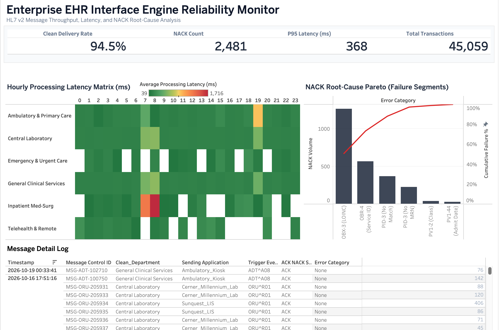

# Enterprise EHR Interface Engine Reliability Monitor
### HL7 v2 Message Throughput, Latency, and NACK Root-Cause Analysis

[](#)
[-emerald)](#)
[](#)

An enterprise health IT operational monitoring and business intelligence framework designed to audit real-time HL7 v2 message feed reliability, detect interface queue bottlenecks, and isolate root causes for Negative Acknowledgments (NACKs) across hospital interface engines into central Electronic Health Record (Epic) endpoints.



---

## 🏥 Clinical & Operational Problem

Hospital interface engines (e.g., Mirth Connect, Corepoint) process tens of thousands of automated HL7 transactions daily between ancillary departmental systems, automated analyzers, and the central EHR.

When message queues lag or fail:
* Delayed Diagnostics: Critical laboratory observations (ORU^R01) from automated analyzers fail to post to the patient chart, directly stalling physician treatment decisions.
* Patient Safety & Identity Risk: Admission, discharge, and transfer feeds (ADT^A01, ADT^A08) drop, leading to unmatched patient identifiers, missing encounters, or duplicate Medical Record Numbers (MRNs).
* Operational Blind Spots: Health IT leadership and integration analysts lack centralized visibility into service-level agreement (SLA) clean-delivery compliance, P95 processing latency, and the root causes behind Negative Acknowledgments (NACKs).

This project models and analyzes 45,000+ HL7 transactions to identify feed bottlenecks, assess latency percentiles, and prioritize interface error remediation.

---

## 📊 Core Performance Benchmarks (24-Hour Queue Window)

| Metric | Measured Value | SLA Target Benchmark | Operational Status |
| :--- | :--- | :--- | :--- |
| Total Ingestion Volume | 45,059 messages | 24-hr queue window | Nominal |
| Clean Delivery Rate | 94.5% | >= 98.0% | ⚠️ Under SLA |
| P95 Processing Latency | 368 ms | < 500 ms | ✅ Optimal |
| Total NACK Failures | 2,481 records | < 2.0% failure threshold | ⚠️ Action Required |

---

## 🏗️ Architecture & Data Pipeline

```text
[ Synthea Patient Encounters & Lab Observations (data/raw/) ]
                         │
                         ▼
        [ Python Simulation & Transformation Engine ]
          (scripts/transform_synthea_to_hl7.py)
   - Maps clinical events to HL7 v2 trigger events
   - Generates MSH-10 Message Control IDs & endpoint routing
   - Models realistic shift-change latency distributions
   - Injects standard HL7 error codes (AE, AR) & segment tags
                         │
                         ▼
          [ Fact_HL7_Transactions.csv (data/processed/) ]
                         │
                         ▼
       [ Dimensional Star Schema Modeling (BI Layer) ]
          ├── Dim_MessageType (ADT, ORU, ORM, MDM)
          ├── Dim_SystemEndpoint (Roche Cobas, Sunquest LIS, Epic Prelude)
          ├── Dim_Department (Inpatient Med-Surg, Central Lab, ED, Ambulatory)
          └── Dim_ErrorCategory (PID-3, OBX-3, OBR-4, PV1-2)
                         │
                         ▼
     [ Executive Operational Dashboard (dashboards/ExecutiveVisualisations.twbx) ]
```

---

## 🛠️ Dashboard Visualizations & Diagnostic Workflow

The monitor follows a three-tier operational triage framework:

### 1. Executive SLA Scorecard (Top Banner)
Provides an instant health check across core operational metrics: Clean Delivery Rate (94.5%), Total NACKs (2,481), P95 Ingestion Latency (368 ms), and Total Message Volume (45,059).

### 2. Diagnostic & Root-Cause Layer (Middle Section)
* Hourly Processing Latency Matrix (ms): A 24-hour heat matrix displaying message processing latency across clinical departments. It pinpoints severe queue bottlenecks (>1,200 ms) occurring during 07:00–08:00 AM and 07:00 PM clinical shift handoffs in Inpatient Med-Surg.
* NACK Root-Cause Pareto Chart (80/20): A dual-axis failure analysis isolating the frequency and cumulative impact of failing HL7 segments. It demonstrates that OBX-3 (Unmapped LOINC Code) and PID-3 (Missing/Unmatched Primary MRN) account for over 75% of all interface drops.

### 3. Interactive Message Detail & Triage Log (Bottom Section)
An operational tabular log with dynamic cross-filtering. Selecting any alert cell in the Hourly Matrix or any failure bar in the Pareto Chart filters the table to display the exact failing Message Control ID, Sending Application, Timestamp, and Error Category ready for analyst verification and payload reprocessing.

---

## 📋 HL7 v2 Message Type & Endpoint Mapping

| Trigger Event | Description | Source Application | Receiving EHR Endpoint |
| :--- | :--- | :--- | :--- |
| ADT^A01 | Patient Inpatient Admission | Epic Prelude | Epic Inpatient Prod |
| ADT^A08 | Patient Demographics / Class Update | Ambulatory Check-in Kiosk | Epic Inpatient Prod |
| ORU^R01 | Unsolicited Diagnostic Lab Results | Sunquest LIS / Roche Cobas | Epic Inpatient Prod |
| ORM^O01 | Clinical Order Entry | Inpatient CPOE Workstations | Interface Engine Core |
| MDM^T02 | Clinical Notes & Transcriptions | Transcription Subsystem | Epic Inpatient Prod |

---

## 🔍 Key Findings & Remediation Protocol

1. Upstream Registration Validation (PID-3): Missing MRNs from ambulatory check-in kiosks account for the majority of ADT failures. Action: Enforce mandatory client-side field validation on patient intake kiosks before message dispatch.
2. LOINC Mapping Drift (OBX-3): Laboratory analyzers introduced updated test batteries without corresponding translation table updates in the interface engine. Action: Deploy automated quarterly LOINC dictionary reconciliation scripts across interface routing tables.
3. Shift-Change Queue Delays: Inpatient ward admissions peak sharply at 08:00 and 19:00, driving queue latency past 1,200 ms. Action: Adjust interface engine thread pooling and thread allocation to prioritize high-acuity inpatient feeds during scheduled nurse shift handoffs.

---

## 📁 Repository Structure

```text
├── dashboards/
│   └── ExecutiveVisualisations.twbx    # Packaged Tableau dashboard workbook
├── data/
│   ├── raw/                            # Ingested synthetic clinical records
│   └── processed/                      # Transformed HL7 interface transaction logs
├── docs/
│   ├── interface_specifications.md     # HL7 segment mappings, trigger events & error protocol
│   └── screenshots/                    # High-resolution dashboard captures
├── scripts/
│   └── transform_synthea_to_hl7.py     # ETL and HL7 transaction simulation script
├── .gitignore
├── README.md
└── requirements.txt
```

---

## 🚀 How to Run the Pipeline Locally

### 1. Prerequisites
* Python 3.10+
* Tableau Desktop (or Tableau Public)

### 2. Setup Environment
```bash
git clone https://github.com/<your-username>/ehr-interface-reliability-monitor.git
cd ehr-interface-reliability-monitor

python -m venv venv
source venv/bin/activate  # On Windows: venv\Scripts\activate
pip install -r requirements.txt
```

### 3. Execute Transformation
Place raw encounter and observation CSV exports in data/raw/ and run:
```bash
python scripts/transform_synthea_to_hl7.py
```
This processes the raw inputs and outputs the formatted star schema dataset to data/processed/Fact_HL7_Transactions.csv.

---

## 📄 Interface Specifications

For detailed segment mapping tables, HL7 delimiters, and NACK resolution workflows, refer to the [Interface Specification Document (ISD)](docs/interface_specifications.md).

---

## 🔒 Security & HIPAA Statement

All patient records, encounters, and message payloads utilized in this repository are synthetically generated. No Protected Health Information (PHI) or proprietary hospital configurations were used, maintaining full compliance with HIPAA privacy standards.
